# 🌳 Living tree

An animated tree for a GitHub profile. It grows with your commits, sways in the wind,
changes with the seasons, sleeps when the sun goes down, and withers if you neglect it.





---

## How it works

```
 GitHub API ──► scripts/generate.mjs ──► src/tree.js ──► tree.svg ──► profile README
 (your commits)   (Action, every 30 min)   (draws it)    ("output" branch)
```

1. A **GitHub Action** (`.github/workflows/tree.yml`) runs every 30 minutes.
   It runs on GitHub's servers for free and needs neither your computer nor Claude.
2. Through the GitHub GraphQL API the script fetches:
   - the **total number of contributions** across all years, which sets the tree's **size**,
   - the **calendar for the last year**, used to work out how active you were in the last 30 days.
3. `src/tree.js` turns that into an **animated SVG** (no JavaScript, just SVG + CSS),
   so GitHub shows it like any other image.
4. The images are published to a separate `output` branch, and the profile README just displays them.

### What affects what

| Data | Effect on the tree |
|---|---|
| Total contributions | Size and branching (logarithmic: the first commits grow it fast, later ones slower) |
| Active days in the last 30 | Leaf density and how green it is |
| Days since the last commit | After 5 days without a commit the leaves start turning yellow and falling |
| Current month | Season: spring = blossoms, summer = fruit, autumn = colourful leaves, winter = snow |
| Time of day (Zagreb) | Day: sun, clouds and birds. After sunset, night: moon, stars and fireflies (more activity = more fireflies) |
| Your username | The tree's **shape**. Every user gets their own unique tree, which always stays the same and only grows |

### Day and night by the clock

Every time the Action runs, `src/sun.js` computes that day's sunrise and sunset at the
configured location (Zagreb by default). Before sunrise and after sunset it draws night,
in between it draws day. In winter night falls around 16:15, in summer around 20:50.

- Every visitor sees **your** time, wherever they are and whatever theme they use.
- The switch can lag by up to ~30 min (the gap between runs), plus a few minutes of GitHub's image cache.
- Change the location in the workflow: `TREE_LAT` / `TREE_LON`.
- If you'd rather have day/night follow the visitor's theme: `TREE_DAYNIGHT: theme`.

### Growth stages

| Contributions | Stage |
|---|---|
| 0 | Seed |
| 1+ | Sprout |
| 10+ | Seedling |
| 50+ | Young tree |
| 200+ | Tree |
| 600+ | Leafy tree |
| 1500+ | Ancient tree (full size at ~2000) |

### Two styles

- **Classic** (`tree.svg`, `tree-light.svg`, `tree-dark.svg`): an illustrated tree with sky, clouds and grass.
- **ASCII / Matrix** (`tree-ascii.svg`, `tree-ascii-light.svg`, `tree-ascii-dark.svg`): the same tree,
  drawn with characters in a terminal style. Branches are `| / \ _`, leaves are keyboard symbols
  (`@ & % # * $ 8 0 o`), and a "Matrix rain" falls in the background. Rows of characters sway in
  the wind (higher rows more), some leaves "glitch" and change character, and at the bottom there is
  a status line with a blinking cursor. A neglected tree is left as a bare skeleton of `/ \ |` with
  a few yellow leaves. **By day** it's a light terminal with an ASCII sun, clouds and birds;
  **by night** it's a black Matrix with a moon, stars and fireflies.

Both styles use the same geometry, so the tree has the same shape. The generator makes both every run.

### Animations

- **Wind:** every branch rotates around its base (SVG `animateTransform`). Branches are nested,
  so the motions add up and the tips sway more than the trunk. Gusts travel from left to right:
  branches on the right lag a fraction of a second behind.
- **Leaves** flutter around their stalks (CSS animations), **falling leaves** drift to the ground,
  and clouds, grass, snow and fireflies have their own animations.
- Everything is deterministic, so the same data always produces the same image.

### Keepalive

GitHub disables scheduled workflows in a repository with no activity for 60 days. Once a day
the workflow re-enables itself through the API, which resets that timer, so the tree keeps
growing even if you don't push anything to this repository.

---

## Running locally

All you need is **Node.js 20+**, no `npm install`.

```bash
npm run preview
```
Open http://localhost:4173. It's a "lab" with sliders: change the number of commits, activity,
season and day/night, or run a **growth time-lapse**.

```bash
npm run demo
```
Generates the SVGs in `dist/` from made-up data.

```bash
npm run generate -- --user YOUR_USERNAME
```
Generates them from real data. Needs a token: `gh auth login` or a `GITHUB_TOKEN` variable.

Options: `--lang hr`, `--season winter`, `--hemisphere south`, `--out folder`,
`--daynight theme`, `--lat 43.51 --lon 16.44` (e.g. Split), `--at 2026-11-06T18:00:00Z` (pretend it's that time).

---

## Setting it up on your own GitHub profile

1. Create a **public** repository named **exactly like your username**
   (e.g. `octocat/octocat`). It's a special "profile" repo whose README shows on your profile.
2. Copy this whole project into it (`src/`, `scripts/`, `.github/`, `package.json`).
3. Push. The Action runs straight away and creates the `output` branch.
4. Add one of these to the profile `README.md` (replace `USERNAME`).

**ASCII / Matrix** (day/night by the clock):

```html

```

**Classic** (day/night by the clock):

```html

```

If you'd rather have day/night follow the visitor's theme (light GitHub = day, dark = night):

```html
<picture>
  <source media="(prefers-color-scheme: dark)" srcset="https://raw.githubusercontent.com/USERNAME/USERNAME/output/tree-ascii-dark.svg">
  
</picture>
```

(same for the classic style, just with `tree-dark.svg` / `tree-light.svg`)

> 💡 To count commits from private repositories too: on your profile, open
> **Contribution settings → Private contributions** and turn it on.

---

## Structure

```
src/tree.js              SVG generator (pure function, runs in Node and the browser)
src/ascii.js             ASCII / Matrix style (uses the geometry from tree.js)
src/sun.js               sunrise and sunset (day/night by the clock)
scripts/generate.mjs     fetches the data from GitHub and writes the SVGs
scripts/serve.mjs        tiny server for the local preview
preview/index.html       lab with sliders and a time-lapse
.github/workflows/       the GitHub Action (every 30 min + keepalive)
```

## Customising

In `src/tree.js` you can easily change:
- `FULL_GROWN`, the number of contributions for full size (default 2000),
- `PALETTES`, leaf colours per season,
- `healthOf()`, how fast the tree withers,
- `MAXD` and the branching rules in `buildStructure()`, for a denser or sparser tree.

Label language: `TREE_LANG: en` or `hr` in the workflow.
