# 🌳 Living tree

An animated tree for a GitHub profile. It is always fully grown, and it shows the
**real weather in Zagreb right now**: sun, clouds, rain, snow, fog or a thunderstorm.
The wind makes it sway, the seasons change its leaves, and when the sun sets it goes to night.




---

## How it works

```
 Open-Meteo ──► scripts/generate.mjs ──► src/tree.js / src/ascii.js ──► SVG ──► profile README
 (weather now)   (Action, every 30 min)   (draws the tree + weather)   ("output" branch)
```

1. A **GitHub Action** (`.github/workflows/tree.yml`) runs every 30 minutes on GitHub's
   servers, for free. It needs neither your computer nor Claude.
2. It fetches the current weather for Zagreb from [Open-Meteo](https://open-meteo.com)
   (free, no API key): temperature, weather code, wind speed and cloud cover.
3. `src/sun.js` works out whether the sun is up in Zagreb at that moment.
4. `src/tree.js` and `src/ascii.js` turn that into **animated SVGs** (no JavaScript,
   just SVG + CSS), so GitHub shows them like any other image.
5. The images are published to a separate `output` branch, and the profile README displays them.

If the weather service is unreachable, the tree is drawn under a calm sky and the
status line says "weather offline". The next run fixes it.

### What affects what

| Data | Effect |
|---|---|
| Weather code | Clear: sun / moon and stars. Partly cloudy: a few clouds. Overcast: a grey sky full of clouds. Fog: drifting fog bands. Drizzle / rain / showers: falling drops, more for heavier rain. Snow: snowflakes and a white ground. Thunderstorm: heavy rain, dark clouds, lightning flashes |
| Wind speed | How hard and how fast the tree sways, how fast the clouds move, how slanted the rain falls, how many leaves blow off. Birds stay home above 35 km/h |
| Temperature | Shown in the status line. Fireflies only come out on warm (12 °C+), dry nights |
| Time of day (Zagreb) | Day: light sky. After sunset: night, with the moon and stars if the sky is clear |
| Current month | Season: spring blossoms, summer fruit, autumn colours, winter frost |
| Your username | The tree's **shape**: every user gets their own unique tree that stays the same |

The status line at the bottom shows the place, temperature, weather, wind and when it was last updated,
for example `[ ZAGREB ] 7°C, light rain, wind 14 km/h | updated 18:37`.

### Day and night by the clock

Every run, `src/sun.js` computes that day's sunrise and sunset in Zagreb. Before sunrise and after
sunset it draws night, in between it draws day. Every visitor sees **your** local time and weather,
wherever they are and whatever theme they use.

- The image can lag by up to ~30 min (the gap between runs), plus a few minutes of GitHub's image cache.
- Change the place in the workflow: `TREE_PLACE`, `TREE_LAT`, `TREE_LON`, `TREE_TZ`.
- If you'd rather have day/night follow the visitor's theme: `TREE_DAYNIGHT: theme`.

### Two styles

- **Classic** (`tree.svg`, `tree-light.svg`, `tree-dark.svg`): an illustrated tree with sky, clouds and grass.
- **ASCII / Matrix** (`tree-ascii.svg`, `tree-ascii-light.svg`, `tree-ascii-dark.svg`): the same tree
  drawn with keyboard characters in a terminal. Rain falls as `| : ,`, snow as `* + .`, fog as `~ - =`,
  and lightning as an ASCII bolt. By day it's a light terminal, by night a black Matrix.

Both styles use the same geometry, and the generator makes all six files every run.

### Keepalive

GitHub disables scheduled workflows in a repository with no activity for 60 days. Once a day
the workflow re-enables itself through the API, which resets that timer, so the tree keeps
updating even if you never push anything to this repository.

---

## Running locally

All you need is **Node.js 20+**, no `npm install`.

```bash
node scripts/serve.mjs
```
Open http://localhost:4173. It's a "lab" where you can pick the weather, temperature, wind,
season and day/night, or load the live weather for Zagreb.

```bash
node scripts/generate.mjs
```
Generates the SVGs in `dist/` with the live weather.

Options:
- `--weather rain` forces a weather: `clear`, `partly`, `cloudy`, `fog`, `drizzle`, `rain`, `heavy`, `snow`, `storm`
- `--temp 3 --wind 40` set the temperature and wind for a forced weather
- `--at 2026-11-21T19:00:00Z` pretends it's that moment (for day/night)
- `--place Split --lat 43.51 --lon 16.44` another place
- `--season winter`, `--daynight theme`, `--out folder`

---

## Setting it up on your own GitHub profile

1. Create a **public** repository named **exactly like your username**
   (e.g. `octocat/octocat`). It's a special "profile" repo whose README shows on your profile.
2. Copy this whole project into it (`src/`, `scripts/`, `.github/`, `package.json`).
3. Push. The Action runs straight away and creates the `output` branch.
4. Add one of these to the profile `README.md` (replace `USERNAME`):

```html

```

```html

```

---

## Structure

```
src/tree.js              classic SVG generator (pure function, runs in Node and the browser)
src/ascii.js             ASCII / Matrix style (uses the geometry from tree.js)
src/weather.js           current weather from Open-Meteo, weather codes and presets
src/sun.js               sunrise and sunset (day/night by the clock)
scripts/generate.mjs     fetches the weather and writes the SVGs
scripts/serve.mjs        tiny server for the local preview
preview/index.html       lab for trying every weather
.github/workflows/       the GitHub Action (every 30 min + keepalive)
```
