# 🌳 Živo stablo

Animirano stablo za GitHub profil. Raste s tvojim commitovima, njiše se na vjetru,
mijenja se kroz godišnja doba i vene kad ga zanemariš.





---

## Kako radi

```
 GitHub API ──► scripts/generate.mjs ──► src/tree.js ──► dist/tree.svg ──► README profila
 (tvoji commitovi)   (svaki dan, Action)    (crta stablo)    (grana "output")
```

1. **GitHub Action** (`.github/workflows/tree.yml`) se pokreće svakih 30 minuta.
   Radi na GitHubovim serverima, besplatno, i ne treba mu ni tvoje računalo ni Claude.
2. Skripta preko GitHub GraphQL API-ja dohvati:
   - **ukupan broj doprinosa** kroz sve godine, o čemu ovisi **veličina** stabla,
   - **kalendar zadnjih godinu dana**, iz kojeg se računa koliko si bio aktivan zadnjih 30 dana.
3. `src/tree.js` od toga nacrta **animirani SVG** (bez JavaScripta, samo SVG + CSS),
   pa ga GitHub normalno prikaže kao sliku.
4. Slika se objavi na zasebnu granu `output`, a profilni README je samo prikazuje.

### Što utječe na što

| Podatak | Učinak na stablo |
|---|---|
| Ukupno doprinosa | Veličina i razgranatost (logaritamski: prvi commitovi brzo daju rast, kasnije sporije) |
| Aktivni dani u zadnjih 30 | Gustoća lišća i koliko je zeleno |
| Dana od zadnjeg commita | Nakon 5 dana bez commita lišće počne žutjeti i opadati |
| Trenutni mjesec | Godišnje doba: proljeće = cvjetovi, ljeto = plodovi, jesen = šareno lišće, zima = snijeg |
| Tvoj username | **Oblik** stabla. Svaki korisnik ima svoje jedinstveno stablo, koje uvijek ostaje isto i samo raste |
| Doba dana (Zagreb) | Danju sunce, oblaci i ptice. Nakon zalaska sunca noć: mjesec, zvijezde i krijesnice (više aktivnosti = više krijesnica) |

### Dan i noć po satu

Svaki put kad se Action pokrene, `src/sun.js` izračuna izlazak i zalazak sunca za taj dan
na zadanoj lokaciji (zadano Zagreb). Prije izlaska i nakon zalaska sunca crta se noć, a između dan.
Zimi noć počinje oko 16:15, a ljeti oko 20:50.

- Svi posjetitelji vide **tvoje** vrijeme, bez obzira na to gdje su i koju temu koriste.
- Prijelaz kasni do ~30 min (razmak između pokretanja), plus koju minutu zbog GitHubovog cachea slika.
- Lokacija se mijenja u workflowu: `TREE_LAT` / `TREE_LON`.
- Ako ipak želiš da dan i noć prate temu posjetitelja: `TREE_DAYNIGHT: theme`.

### Faze rasta

| Doprinosa | Faza |
|---|---|
| 0 | Sjemenka |
| 1+ | Klica |
| 10+ | Mladica |
| 50+ | Mlado stablo |
| 200+ | Stablo |
| 600+ | Krošnjato stablo |
| 1500+ | Prastaro stablo (puna veličina ~2000) |

### Dva stila

- **Klasično** (`tree-light.svg`, `tree-dark.svg`, `tree.svg`): ilustrirano stablo s nebom, oblacima i travom.
- **ASCII / Matrix** (`tree-ascii.svg`, `tree-ascii-light.svg`, `tree-ascii-dark.svg`): isto stablo, ali iscrtano znakovima u terminalskom stilu.
  Grane su `| /  _`, lišće su znakovi s tipkovnice (`@ & % # * $ 8 0 o`), a u pozadini pada
  "Matrix kiša". Redovi znakova se njišu na vjetru (viši redovi jače), neki listovi
  "glitchaju" i mijenjaju znak, a dolje je statusna linija s trepćućim kursorom.
  Zapušteno stablo ostane goli kostur od `/  |` s par žutih listova.
  Ima dnevnu i noćnu verziju: **danju** je svijetli terminal s ASCII suncem, oblacima i
  pticama, a **noću** crni Matrix s mjesecom, zvijezdama i krijesnicama.

Oba stila koriste istu geometriju, pa je oblik stabla isti. Generator svaki dan napravi oba.

### Animacije

- **Vjetar:** svaka grana se rotira oko svoje baze (SVG `animateTransform`). Grane su
  ugniježđene, pa se pokreti zbrajaju i vrhovi se njišu više od debla. Udar vjetra
  putuje slijeva nadesno: grane desno kasne djelić sekunde.
- **Lišće** treperi oko peteljke (CSS animacije), **padajući listovi** lete prema tlu,
  a oblaci, trava, snijeg i krijesnice imaju svoje animacije.
- Sve je deterministično, pa isti podaci uvijek daju istu sliku.

---

## Lokalno

Treba samo **Node.js 20+**, bez `npm install`.

```bash
npm run preview
```
Otvori http://localhost:4173. To je "laboratorij" sa sliderima: možeš mijenjati broj
commitova, aktivnost, godišnje doba i temu, te pokrenuti **time-lapse rasta**.

```bash
npm run demo
```
Generira `dist/tree.svg` iz izmišljenih podataka.

```bash
npm run generate -- --user TVOJ_USERNAME
```
Generira iz pravih podataka. Treba token: `gh auth login` ili varijabla `GITHUB_TOKEN`.

Opcije: `--lang en`, `--season winter`, `--hemisphere south`, `--out mapa`,
`--daynight theme`, `--lat 43.51 --lon 16.44` (npr. Split), `--at 2026-11-06T18:00:00Z` (kao da je to vrijeme).

---

## Postavljanje na GitHub profil

1. Napravi **javni** repozitorij koji se zove **točno kao tvoj username**
   (npr. `josip/josip`). To je poseban "profilni" repo i njegov README se prikazuje na profilu.
2. Kopiraj u njega cijeli ovaj projekt (`src/`, `scripts/`, `.github/`, `package.json`).
3. Na GitHubu: **Settings → Actions → General → Workflow permissions → Read and write permissions**.
4. **Actions → 🌳 Zalij stablo → Run workflow** pokreće prvo generiranje odmah, bez čekanja.
5. U `README.md` profila dodaj jedno od ovoga (zamijeni `USERNAME`).

**ASCII / Matrix** (dan i noć po satu u Zagrebu):

```html

```

**Klasično** (dan i noć po satu u Zagrebu):

```html

```

Ako radije želiš da dan i noć prate temu posjetitelja (svijetli GitHub = dan, tamni = noć):

```html
<picture>
  <source media="(prefers-color-scheme: dark)" srcset="https://raw.githubusercontent.com/USERNAME/USERNAME/output/tree-ascii-dark.svg">
  
</picture>
```

(za klasični stil isto, samo `tree-dark.svg` / `tree-light.svg`)

> 💡 Ako želiš da se broje i commitovi iz privatnih repozitorija: na profilu
> **Contribution settings → Private contributions** uključi prikaz.

---

## Struktura

```
src/tree.js              generator SVG-a (čista funkcija, radi u Node-u i browseru)
src/ascii.js             ASCII / Matrix stil (koristi geometriju iz tree.js)
src/sun.js               izlazak i zalazak sunca (dan/noć po satu)
scripts/generate.mjs     dohvat podataka s GitHuba i spremanje SVG-ova
scripts/serve.mjs        mini server za lokalni preview
preview/index.html       laboratorij sa sliderima i time-lapseom
.github/workflows/       dnevni GitHub Action
```

## Prilagodbe

U `src/tree.js` lako se mijenja:
- `FULL_GROWN`, broj doprinosa za punu veličinu (zadano 2000),
- `PALETTES`, boje lišća po godišnjim dobima,
- `healthOf()`, koliko brzo stablo vene,
- `MAXD` i pravila grananja u `buildStructure()`, za gušće ili rjeđe stablo.
